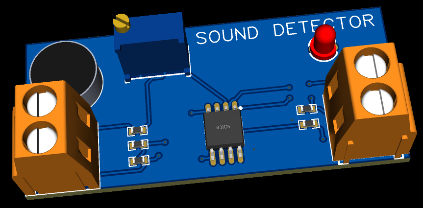
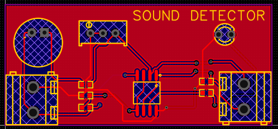
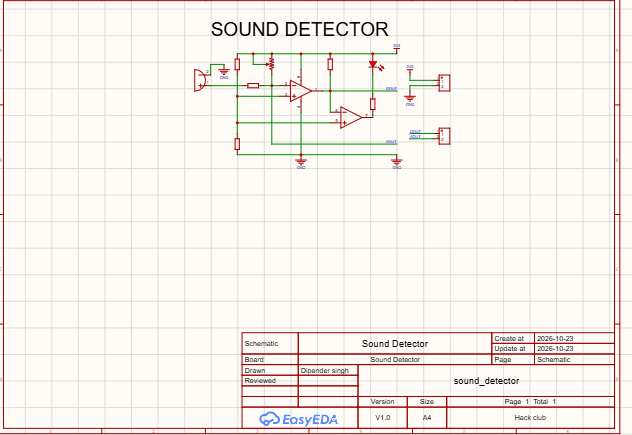

# Sound Detector — PCB Design

A custom PCB designed to detect sound using a microphone and a custom designed Printed Circuit Board (PCB).

## Demo Video

▶️ [Demo video](https://www.youtube.com/watch?v=PWUpOuOhq_U)

## About Project

This project provides PCB design, manufacturing files, Bill of Materials (BOM), and a 3D PCB model.
Anyone interested in electronics can download the files, manufacture the PCB, purchase the required components, assemble the circuit, and test the Sound Detector.

## Build Your Own Sound Detector PCB

1. Download the project files from this repository.
2. Check `BOM.xlsx` and purchase the required components.
3. Upload the Gerber files to a PCB manufacturer.
4. Solder the components onto the fabricated PCB.
5. Power the circuit and test sound detection.

## Working

A microphone receives sound and converts it into an electrical signal. The circuit processes this signal, and a comparator-based stage can indicate when the signal crosses a configured threshold.
The actual detection threshold, operating voltage, and output behavior should be confirmed using the schematic and physical testing.

## Project Preview

### 3D PCB Model

### PCB Layout

### Circuit Schematic

## License

No open-source license has been selected yet. Check the applicable ownership and licensing permissions before redistributing or manufacturing this design.

---
